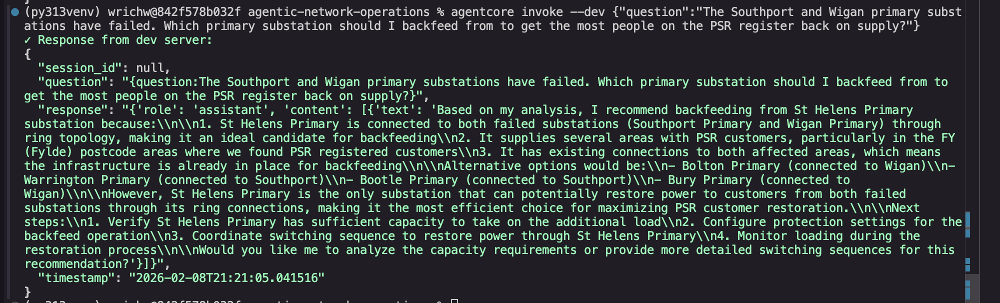
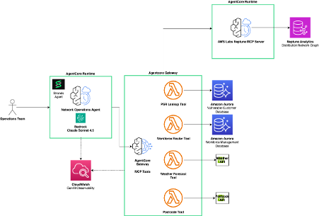

# Agentic Operations for the Unicorn Power Electricity Distribution Network

A comprehensive graph database model of a realistic UK electricity distribution network for the North West England region, operated by the fictional companies **Unicorn Energy Networks** (DNO) with retail supply by **Unicorn Power**.

**Built for AI Agent Demos**: This project uses Amazon Neptune Analytics for serverless graph analytics, optimized for AI agent integration and proof-of-concept demonstrations.

**Demo data notice**: Real town names and coordinates are used only as geographic references. Network, customer, PSR, workforce, and operational records are synthetic. This repository contains no real customer, PSR, or live operational data.

## Demo questions



`agentcore invoke '{"prompt":"which primary substations are fed from the grid supply point in cumbria?"}'`
This demonstrates the agents ability to compose multiple cypher queries from a natural language prompt and to understand the network graph; the agent is not specialised in any way to this task and has no prior knowledge of the graph in the demo code.

`agentcore invoke '{"prompt":"The Southport and Wigan primary substations have failed. Which primary substation should I backfeed from to get the most people on the PSR register back on supply?"}'`

This demonstrates the agent's ability to use multiple tools, compose complex cypher queries to traverse the network graph and determine the numbers of properties affected, correlate this to data in the PSR register and make intelligent decisions about how to resolve the problem; in this instance it will typically realise that both substations can be backfed rather than answering the question as posed.

`agentcore invoke '{"prompt":"there is a transformer fault at the Wigan primary substation, who do I have available to fix it?"}'`

This shows the ability to select the appropriate tool and map natural language to available skills

`agentcore invoke '{"prompt":"Is there any heavy rainfall due in the Warrington area over the next week?"}'`

This shows the agent's ability to use multiple tools to translate a place name into a geolocation and look at the weather forecast for that area to see if weather conditions will pose a challenge to network operations or engineer dispatch activities.

`agentcore invoke '{"prompt":"Will next week's weather forecast impact any substations in the North West?"}'`

This shows the agent's ability to chain together multiple tools to look at the netowork topology to find substations in a given area and check the weather at a representative sample of locations.

## Quick Links

- **[QUICK_START.md](documents/QUICK_START.md)** - 5-minute setup guide
- **[NEPTUNE_ANALYTICS_SETUP.md](documents/NEPTUNE_ANALYTICS_SETUP.md)** - Detailed setup instructions
- **[AI_AGENT_INTEGRATION.md](documents/AI_AGENT_INTEGRATION.md)** - AI agent query guide
- **[Graph Schema.md](documents/graph_schema.md)** - Complete graph schema reference

## Overview

This project models a complete electricity distribution network serving 10,000 properties across North West England, including:

- **Geographic Coverage**: Greater Manchester, Merseyside, Lancashire, Cheshire, and Cumbria
- **Major Cities**: Manchester, Liverpool, Preston, Chester, Carlisle, Blackpool, Bolton, Warrington
- **Network Components**: Grid Supply Points, Primary Substations, Secondary Substations, Properties
- **Real Geography**: Actual postcodes (M, L, PR, CH, CA, FY, BL, WA) and coordinates
- **Companies**:
  - Unicorn Energy Networks (Distribution Network Operator)
  - Unicorn Power (Electricity Retailer)


Note, the distribution network is entirely synthetic and is for demo'ing capabilities of agents; actual spatial reality such as appropriate physical distance between properties and substations is not well represented.

## Architecture



### Technology Stack

- **Database**: Amazon Neptune Analytics (Serverless Graph Analytics)
- **Query Language**: openCypher (for AI agent queries and analytics)
- **Data Format**: CSV (nodes and edges)
- **Infrastructure**: AWS CLI / Console (no cluster management required)
- **Region**: us-east-1 (Development/Test)
- **Python**: 3.13 virtual environment

## Useful Links

- Cyper query generation - tools vs. LLMs https://memgraph.com/blog/tools-vs-cypher-generation-in-graph-database note the Neptune MCP server has a tool to return the schema

### Model Choice

Currently using: Claude Sonnet 4.5
Have tried: Claude Haiku 4.5

Sonnet provides superior reasoning capabilities e.g. when prompted with "The Southport Primary and Wigan Primary primary substations have failed. Which primary substation should I backfeed from to get the most people on the PSR register back on supply?" Sonnet will realise that both substations can be backfed from a common alternative primary and recommend that thus getting the highest total PSR customers online, rather than taking the query at face value and recommending an alternative for Wigan only (with Wigan having the most PSR customers out of the two).

### Why Neptune Analytics?

**Key Design Decision**: This project uses **Neptune Analytics** instead of Neptune Database for several strategic reasons:

1. **Static Graph Data**: The network topology doesn't change frequently - perfect for import-once, query-many scenarios
2. **Demo-Focused**: Designed to showcase AI agent capabilities, not transactional workloads
3. **Serverless Simplicity**: No cluster management, VPC setup, or ongoing infrastructure costs
4. **Cost-Effective**: Pay-per-query model vs always-on cluster charges
5. **Faster Setup**: Import CSV files and start querying immediately
6. **Agent-Optimized**: Built for analytical queries that AI agents excel at

**When to use Neptune Database instead:**
- Real-time graph updates required
- Transactional workloads with frequent writes
- Sub-millisecond query latency needed
- Complex multi-tenant applications

**When to use Neptune Analytics (this project):**
- Static or slowly-changing graph data ✓
- Analytical queries and pattern matching ✓
- Demo and proof-of-concept projects ✓
- AI agent integration ✓
- Cost-sensitive deployments ✓

### Vector Search Decision

**Key Design Decision**: This project does **not** enable vector similarity search in Neptune Analytics.

**Rationale:**
- **Structured data**: Network topology uses structured attributes (IDs, addresses, numeric values)
- **Graph queries**: Use cases focus on traversals, relationships, and aggregations
- **No unstructured text**: No equipment logs, maintenance notes, or documentation to embed
- **Simplicity**: Vector search adds complexity and cost without clear benefit for this demo

**When to reconsider:**
- Adding unstructured data (maintenance logs, incident reports, technical documentation)
- Need semantic similarity queries ("find similar network configurations")
- Building RAG applications that combine graph structure with semantic search
- Anomaly detection based on consumption pattern similarity

For this demo, **structural graph queries with openCypher** provide all needed functionality.

### Bedrock Knowledgebase GraphRAG vs Direct use of Neptune Analytics

**Key Design Decision**: This project uses **direct Neptune Analytics integration** rather than Bedrock Knowledge Bases GraphRAG.

**Why Direct Integration:**
- **Pre-existing structured graph**: Network topology is already defined with specific node types (substations, properties) and relationships (FEEDS, SUPPLIES, CONNECTS)
- **Operational queries**: AI agents need to traverse the actual network infrastructure (e.g., "which properties are downstream of SS001?")
- **Domain-specific relationships**: Electrical network relationships are meaningful infrastructure connections, not document relationships
- **Query precision**: openCypher queries against the network schema provide exact topology traversals

**Why NOT Bedrock KB GraphRAG:**
- GraphRAG is designed for **unstructured documents** (PDFs, text files) stored in S3
- It automatically extracts entities and builds graphs connecting document chunks and extracted entities
- The resulting graph represents cross-document relationships, not physical infrastructure
- Cannot import pre-existing structured graphs like our electricity network topology
- Optimized for semantic search across documents, not network traversal

### Neptune MCP Server Integration via AgentCore Runtime

**Key Design Decision**: This project deploys the [Amazon Neptune MCP Server](https://github.com/awslabs/mcp/tree/main/src/amazon-neptune-mcp-server) as an **AgentCore Runtime target of AgentCore Gateway**. The Network Operations Agent uses one authenticated Gateway MCP endpoint; Gateway then routes topology requests to the Neptune runtime and operational requests to Lambda targets.

**Current Architecture:**
```
Network Operations Agent → AgentCore Gateway → Neptune MCP Server (AgentCore Runtime) → Neptune Analytics
                                           └→ Lambda targets (PSR, workforce, postcode, weather)
```

**Why Gateway fronts the runtime:**
- **Single agent integration**: Agents need only the Gateway URL and its OAuth configuration.
- **Centralized controls**: Gateway is the point for tool exposure, policy enforcement, audit logging, and future target additions.
- **IAM service-to-service authentication**: Gateway signs requests to the runtime with SigV4; the agent does not receive runtime credentials.
- **Efficient MCP sessions**: Gateway forwards `Mcp-Session-Id` to reuse the runtime MCP session.
- **Preserved runtime benefits**: The official AWS Labs Neptune MCP server remains an independently scalable runtime.

**Why NOT Lambda Wrapper:**
- Would require replicating Neptune MCP server functionality in custom Lambda code
- More code to maintain and test
- Lambda cold starts for graph queries
- Loses benefits of the official AWS Labs implementation

**Neptune MCP Server Capabilities:**
1. **Run Queries**: Execute openCypher queries against Neptune Analytics
2. **Get Schema**: Retrieve graph schema as text for agent context
3. **Check Status**: Verify graph availability before querying

**References:**
- [Amazon Neptune MCP Server](https://github.com/awslabs/mcp/tree/main/src/amazon-neptune-mcp-server)
- [AWS Bedrock AgentCore Developer Guide - MCP servers targets](https://docs.aws.amazon.com/bedrock-agentcore/latest/devguide/gateway-target-MCPservers.html)

### Network Scale

```
Grid Supply Points: 3
├── Primary Substations: 20
│   ├── Secondary Substations: ~150
│   │   └── Properties: 10,000
│   └── Protection Devices: ~40
└── Total Graph: ~10,213 vertices, ~10,200+ edges
```

### Property Distribution

- **75% Residential**: Houses (50%), Flats (25%)
- **20% Commercial**: Shops (10%), Offices (10%)
- **5% Industrial**: Factories (3%), Warehouses (2%)

## Quick Start

### 1. Deploy Infrastructure

```bash
# Deploy S3 bucket and IAM role
sam build
sam deploy --guided

# Note the outputs - you'll need the bucket name and role ARN
```

### 2. Generate and Export Data

```bash
# Activate Python environment
source .venv/bin/activate

# Generate mock network data
python src/generate_network_data.py

# Export to Neptune Analytics CSV format
python src/export_network_to_csv.py --input network_data.json --output-dir neptune_csv
```

### 3. Upload to S3

```bash
# Use the command from SAM outputs, or:
aws s3 sync neptune_csv/ s3://YOUR-BUCKET-NAME/network/ --region us-east-1
```

### 4. Create Neptune Analytics Graph

```bash
# Create graph
aws neptune-graph create-graph \
  --graph-name nw-england-electricity-network \
  --provisioned-memory 128 \
  --region us-east-1

# Import data (use role ARN from SAM outputs)
aws neptune-graph create-graph-using-import-task \
  --graph-name nw-england-electricity-network \
  --source s3://YOUR-BUCKET-NAME/network/ \
  --format CSV \
  --role-arn YOUR-ROLE-ARN \
  --region us-east-1
```

### 5. Query the Network

```bash
# Set this to the graph identifier returned by create-graph-using-import-task.
export NEPTUNE_GRAPH_ID="<your-neptune-graph-id>"

# Run a named, parameterized openCypher example.
python src/query_examples.py \
  --graph-id "${NEPTUNE_GRAPH_ID}" \
  --query properties-by-city \
  --city Manchester
```

The caller needs `neptune-graph:ExecuteQuery` permission for the graph. The
example script uses the Neptune Analytics API over AWS SDK authentication; it
does not open a direct database connection.

## MCP Tools

The project includes Lambda function tools for agent integration:

### 1. PSR Lookup Tool (`lambda_psr_lookup_tool`)
Queries synthetic Priority Services Register-style data by UPRN or MPAN. It demonstrates how an agent can use vulnerability and support indicators; it must not be connected to live customer information without an appropriate security and privacy review.

#### Handling Real PSR Data

Do not connect this sample to live PSR data. Such data can identify vulnerability
or support needs and may include special-category personal data. Before a real
deployment, obtain privacy and legal review, assess UK GDPR obligations
including an appropriate lawful basis and, where applicable, special-category
condition, and implement data minimisation, least-privilege access, encryption,
audit logging, retention controls, and incident processes.

### 2. Postcode to Lat/Long Tool (`lambda-postcode-to-geo-info`)
Converts UK postcodes to geographic coordinates using the [postcodes.io API](https://postcodes.io/). Returns latitude, longitude, region, and parliamentary constituency information.

### 3. Weather Forecast Tool (`lambda-get-forecast-for-latlong`)
Retrieves 7-day weather forecasts for given coordinates using the [Open-Meteo API](https://open-meteo.com/). Identifies significant precipitation events (≥2mm/hour) and high winds (≥40 km/h) critical for network operations planning.

Review the [Open-Meteo terms of use](https://open-meteo.com/en/terms) before commercial or production use. Availability, service limits, and any third-party terms are outside this repository and may change.

### 4. Workforce Router Tool (`lambda_workforce_router`)
Routes workforce dispatch requests and manages field engineer assignments for network maintenance and emergency response.

## Project Structure

```
.
├── agentcore/                         # Gateway, MCP runtime, and operations agent
├── documents/                         # Setup, integration, and graph-schema guides
├── neptune_csv/                       # Sample Neptune Analytics import data
├── psr_register/                      # Synthetic PSR-style data
├── src/
│   ├── frontend/                      # Local Flask demonstration UI
│   ├── lambda-*/                      # Lambda tool implementations
│   ├── workforce_db/                  # Synthetic workforce database assets
│   ├── generate_network_data.py       # Generate synthetic network data
│   ├── export_network_to_csv.py       # Export CSV import data
│   └── query_examples.py              # Parameterized openCypher examples
├── template.yaml                      # SAM template
├── requirements.txt                   # Root Python dependencies
└── README.md                          # This file
```

## Data Model

### Vertex Types

- **GridSupplyPoint**: Connection to transmission system (132kV/275kV)
- **PrimarySubstation**: Steps down to primary distribution (33kV/11kV)
- **SecondarySubstation**: Steps down to low voltage (230V/400V)
- **Property**: End consumer (residential/commercial/industrial)
- **ProtectionDevice**: Circuit breakers and fuses

### Edge Types

- **FEEDS**: GridSupplyPoint → PrimarySubstation
- **SUPPLIES**: PrimarySubstation → SecondarySubstation (ring/mesh topology)
- **CONNECTS**: SecondarySubstation → Property
- **PROTECTS**: ProtectionDevice → Substation

### Key Properties

**Property Identifiers**:
- UPRN: 12-digit Unique Property Reference Number
- MPAN: 21-digit Meter Point Administration Number

**Network Attributes**:
- Voltage levels (kV)
- Capacity (MVA/kVA)
- Cable specifications
- Geographic coordinates
- Company ownership (Unicorn Energy Networks for assets, Unicorn Power for supply)

## Query Examples

### openCypher (Recommended for AI Agents)

```cypher
-- Find all properties in Manchester with smart meters
MATCH (p:Property)
WHERE p.address_city = 'Manchester'
  AND p.has_smart_meter = true
RETURN p

-- Calculate total load on a substation
MATCH (ss:SecondarySubstation {id: 'SS001'})<-[:CONNECTS]-(p:Property)
RETURN ss.id AS substation, SUM(p.peak_demand_kw) AS total_load_kw

-- Find path from grid to a specific property
MATCH path = (gsp:GridSupplyPoint)-[*]->(p:Property {uprn: '100012345678'})
RETURN path
LIMIT 1

-- Find all properties supplied by Unicorn Power in M1 postcode
MATCH (p:Property)
WHERE p.supplier = 'Unicorn Power'
  AND p.postcode STARTS WITH 'M1'
RETURN p
```

## AI Agent Integration

The system is designed for AI agent interaction using openCypher:

### Graph Schema for LLM Context

```
Vertices: GridSupplyPoint, PrimarySubstation, SecondarySubstation, Property, ProtectionDevice
Edges: FEEDS, SUPPLIES, CONNECTS, PROTECTS

Companies:
- Unicorn Energy Networks: DNO (owns network infrastructure)
- Unicorn Power: Retailer (supplies electricity to customers)

Geography: North West England
Cities: Manchester, Liverpool, Preston, Chester, Carlisle, Blackpool, Bolton, Warrington
Postcodes: M (Manchester), L (Liverpool), PR (Preston), CH (Chester), CA (Carlisle), FY (Blackpool), BL (Bolton), WA (Warrington)
```

### Natural Language Query Examples

- "Show me all houses in Manchester connected to substation SS001"
- "What's the total electricity demand on substation SS001?"
- "Find the path from the grid to property with UPRN 100012345678"
- "Which properties in Liverpool have smart meters?"
- "Show all properties supplied by Unicorn Power in the M1 postcode area"

## Documentation

- **[NEPTUNE_ANALYTICS_SETUP.md](documents/NEPTUNE_ANALYTICS_SETUP.md)**: Complete Neptune Analytics setup guide
- **[AI_AGENT_INTEGRATION.md](documents/AI_AGENT_INTEGRATION.md)**: AI agent integration guide with query examples
- **[QUICK_START.md](documents/QUICK_START.md)**: Deployment walkthrough
- **[graph_schema.md](documents/graph_schema.md)**: Graph model reference

## Development

### Prerequisites

- AWS CLI configured with credentials
- Python 3.13 virtual environment
- AWS account with Neptune Analytics permissions
- S3 bucket for CSV file storage

### Python Dependencies

```bash
pip install -r requirements.txt
```

### Environment Variables

```bash
export AWS_REGION=us-east-1
export NEPTUNE_GRAPH_ID=<your-neptune-analytics-graph-id>
```

## Cost Estimate

**Neptune Analytics** (Pay-per-query):
- **Graph Storage**: ~$0.10/GB/month (~$1-5/month for this dataset)
- **Query Compute**: ~$0.10 per million graph traversals
- **S3 Storage**: ~$0.023/GB/month for CSV files (~$0.10/month)
- **Data Transfer**: Minimal for demo usage

**Estimated Monthly Cost**: ~$1-10/month depending on query volume

**Cost Comparison vs Neptune Database:**
- Neptune Database Cluster: ~$62-250/month (always-on)
- Neptune Analytics: ~$1-10/month (pay-per-query)
- **Savings**: 85-95% for demo/development workloads

**Cost Optimization Tips:**
- Delete graph when not in use (no ongoing charges)
- Use S3 Intelligent-Tiering for CSV files
- Query efficiently with filters and limits

## Network Topology

The network implements ring/mesh topology for redundancy:

```
GSP (275kV) → Primary Substations (33kV/11kV) → Secondary Substations (230V/400V) → Properties
     ↓              ↓ ↑ (ring topology)              ↓ ↑ (backup feeders)
  Backup      Alternative Paths                  Redundant Supply
```

## Testing

```bash
# Validate the generated synthetic network data
python src/tests/test_data_generator.py

# Run mocked openCypher query unit tests
PYTHONPATH=src python src/tests/test_basic_queries.py

# Run the AgentCore Gateway architecture regression test
(cd agentcore/network_operations_agent && uv run pytest src/tests/test_gateway_architecture.py)
```

## Monitoring

Neptune Analytics metrics in CloudWatch:
- Query execution time
- Graph storage size
- Query throughput
- Error rates

## Future Enhancements

- Time-series demand data
- Weather data integration (using real North West England geography)
- Network optimization algorithms
- Visualization dashboard
- Real-time monitoring via agent queries
- Fault simulation
- Load flow analysis
- Integration with Bedrock AgentCore for specialized agents

## Support

For issues or questions:
1. Check [NEPTUNE_ANALYTICS_SETUP.md](documents/NEPTUNE_ANALYTICS_SETUP.md) troubleshooting section
2. Review Neptune Analytics documentation
3. Verify CSV format and S3 permissions
4. Check CloudWatch logs for import/query errors

## Third-Party Notices

This repository uses AWS services, third-party Python packages, and external APIs that are provided under their own terms and licenses. Review the dependency declarations in `requirements.txt`, the AgentCore `pyproject.toml`, and the relevant upstream notices before redistribution or production use.

- [AWS Service Terms](https://aws.amazon.com/service-terms/)
- [Open-Meteo Terms of Use](https://open-meteo.com/en/terms)
- [postcodes.io](https://postcodes.io/)
- [AWS Labs Neptune MCP Server](https://github.com/awslabs/mcp/tree/main/src/amazon-neptune-mcp-server)

## References

- [AWS Neptune Analytics Documentation](https://docs.aws.amazon.com/neptune-analytics/)
- [openCypher Documentation](https://opencypher.org/)
- [Neptune Analytics CSV Format](https://docs.aws.amazon.com/neptune-analytics/latest/userguide/csv-format.html)
- [UK Electricity Distribution Standards](https://www.energynetworks.org/)
- [Amazon Bedrock AgentCore](https://docs.aws.amazon.com/bedrock/)

## Security

See [CONTRIBUTING](CONTRIBUTING.md#security-issue-notifications) for more information.

## License

This library is licensed under the MIT-0 License. See the LICENSE file.
